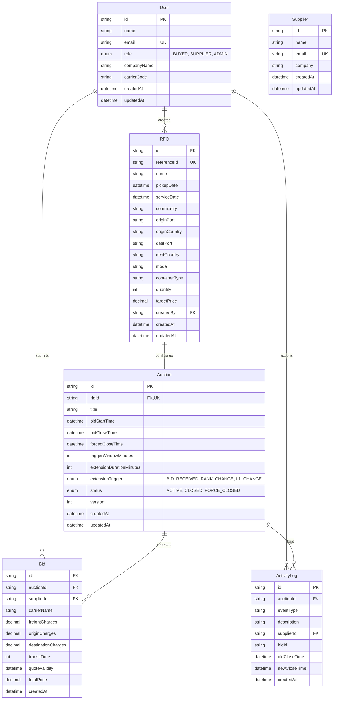

# Database Architecture & Design Document (MySQL + Prisma ORM)

## 1. Overview

This document specifies the relational database schema, indexes, integrity constraints, and transaction architecture for the **British Reverse Auction RFQ Procurement System**.

The database uses **MySQL** as the primary relational database with **Prisma ORM** for schema definition, migrations, and query generation. MySQL provides strong ACID guarantees, table and row-level locking (`FOR UPDATE`), read committed / repeatable read isolation levels, and strict relational integrity essential for procurement and real-time reverse auction engines.

---

## 2. Entity Relationship Diagram (ERD)

---

## 3. Detailed Table Specifications

### 3.1 `users`
Stores system actors: procurement buyers and freight suppliers/carriers.

| Field Name | Type | Constraints / Attributes | Description |
|---|---|---|---|
| `id` | VARCHAR(36) | Primary Key, UUID | Unique user identifier |
| `name` | VARCHAR(191) | NOT NULL | Full name of the user or contact person |
| `email` | VARCHAR(191) | NOT NULL, UNIQUE | User email address for authentication and notifications |
| `role` | ENUM | BUYER, SUPPLIER, ADMIN | System role governing permissions |
| `companyName`| VARCHAR(191) | NULLABLE | Registered company/carrier name |
| `carrierCode`| VARCHAR(20) | NULLABLE | Standard carrier alphanumeric code (e.g., `MAEU`, `HLCU`) |
| `createdAt` | DATETIME | NOT NULL, DEFAULT `CURRENT_TIMESTAMP` | Record creation timestamp |
| `updatedAt` | DATETIME | NOT NULL, ON UPDATE `CURRENT_TIMESTAMP` | Last updated timestamp |

### 3.2 `suppliers`
Dedicated supplier entity representation for supplier directory queries.

| Field Name | Type | Constraints / Attributes | Description |
|---|---|---|---|
| `id` | VARCHAR(36) | Primary Key, UUID | Unique supplier identifier |
| `name` | VARCHAR(191) | NOT NULL | Contact name |
| `email` | VARCHAR(191) | NOT NULL, UNIQUE | Primary supplier email |
| `company` | VARCHAR(191) | NOT NULL | Supplier company name |
| `createdAt` | DATETIME | NOT NULL, DEFAULT `CURRENT_TIMESTAMP` | Supplier registration timestamp |
| `updatedAt` | DATETIME | NOT NULL, ON UPDATE `CURRENT_TIMESTAMP` | Last updated timestamp |

### 3.3 `rfqs`
Request For Quotation (RFQ) procurement records initiated by buyers.

| Field Name | Type | Constraints / Attributes | Description |
|---|---|---|---|
| `id` | VARCHAR(36) | Primary Key, UUID | Unique RFQ record identifier |
| `referenceId`| VARCHAR(64) | NOT NULL, UNIQUE | Business reference code (e.g. `RFQ-2026-MUM-ROT`) |
| `name` | VARCHAR(255) | NOT NULL | RFQ title / freight contract description |
| `pickupDate` | DATETIME | NOT NULL | Scheduled cargo pickup date |
| `serviceDate`| DATETIME | NULLABLE | Target delivery / arrival date |
| `commodity` | VARCHAR(191) | NULLABLE | Goods description |
| `originPort` | VARCHAR(191) | NULLABLE | Origin port or terminal name |
| `originCountry`| VARCHAR(100)| NULLABLE | Origin nation |
| `destPort` | VARCHAR(191) | NULLABLE | Destination port or terminal name |
| `destCountry`| VARCHAR(100)| NULLABLE | Destination nation |
| `mode` | VARCHAR(50) | DEFAULT `OCEAN_FCL` | Transport mode (`OCEAN_FCL`, `AIR`, `TRUCK`) |
| `containerType`| VARCHAR(50)| DEFAULT `40ft High Cube (40HC)` | Equipment specifications |
| `quantity` | INT | DEFAULT 1 | Number of units / containers |
| `targetPrice`| DECIMAL(12,2)| NULLABLE | Buyer budget / baseline target quote |
| `createdBy` | VARCHAR(36) | Foreign Key -> `users.id` | Buyer who authored the RFQ |
| `createdAt` | DATETIME | NOT NULL, DEFAULT `CURRENT_TIMESTAMP` | Creation timestamp |
| `updatedAt` | DATETIME | NOT NULL, ON UPDATE `CURRENT_TIMESTAMP` | Last modification timestamp |

**Indexes**:
- `@@index([createdBy])`

---

### 3.4 `auctions`
Contains British Reverse Auction configuration, status, and dynamic timing boundaries.

| Field Name | Type | Constraints / Attributes | Description |
|---|---|---|---|
| `id` | VARCHAR(36) | Primary Key, UUID | Unique auction identifier |
| `rfqId` | VARCHAR(36) | Foreign Key -> `rfqs.id`, UNIQUE | 1-to-1 association with RFQ |
| `title` | VARCHAR(255) | NOT NULL | Auction display title |
| `bidStartTime` | DATETIME | NOT NULL | Bidding window opening time |
| `bidCloseTime` | DATETIME | NOT NULL | Dynamically extendable auction close time |
| `forcedCloseTime`| DATETIME | NOT NULL | Immutable ceiling time beyond which no extension can occur |
| `triggerWindowMinutes` | INT | NOT NULL, DEFAULT 10 | Window before `bidCloseTime` monitored for triggers |
| `extensionDurationMinutes`| INT| NOT NULL, DEFAULT 5 | Minutes added to `bidCloseTime` upon qualifying trigger |
| `extensionTrigger` | ENUM | `BID_RECEIVED`, `RANK_CHANGE`, `L1_CHANGE` | Mode determining qualifying events |
| `status` | ENUM | `ACTIVE`, `CLOSED`, `FORCE_CLOSED` | Current auction lifecycle state |
| `version` | INT | NOT NULL, DEFAULT 1 | Optimistic concurrency control counter |
| `createdAt` | DATETIME | NOT NULL, DEFAULT `CURRENT_TIMESTAMP` | Record creation timestamp |
| `updatedAt` | DATETIME | NOT NULL, ON UPDATE `CURRENT_TIMESTAMP` | Last updated timestamp |

**Indexes**:
- `@@index([status])`
- `@@index([bidCloseTime])`
- `@@index([forcedCloseTime])`

---

### 3.5 `bids`
Stores all submitted supplier quotes.

| Field Name | Type | Constraints / Attributes | Description |
|---|---|---|---|
| `id` | VARCHAR(36) | Primary Key, UUID | Unique bid record identifier |
| `auctionId` | VARCHAR(36) | Foreign Key -> `auctions.id` | Associated auction |
| `supplierId` | VARCHAR(36) | Foreign Key -> `users.id` | Submitting supplier / carrier |
| `carrierName`| VARCHAR(191) | NOT NULL | Operating carrier/vessel designation |
| `freightCharges` | DECIMAL(12,2) | NOT NULL | Ocean/air base freight quote (must be > 0) |
| `originCharges` | DECIMAL(12,2) | NOT NULL, DEFAULT 0.00 | Terminal handling and origin ancillary charges |
| `destinationCharges` | DECIMAL(12,2) | NOT NULL, DEFAULT 0.00 | Destination discharge & delivery fees |
| `transitTime` | INT | NOT NULL, DEFAULT 15 | Transit duration in days |
| `quoteValidity`| DATETIME | NOT NULL | Quote expiry date (must be in future) |
| `totalPrice` | DECIMAL(12,2) | NOT NULL | Evaluated price: freight + origin + destination |
| `createdAt` | DATETIME | NOT NULL, DEFAULT `CURRENT_TIMESTAMP` | Bid submission timestamp (used for tie-breaking) |

**Indexes**:
- `@@index([auctionId])`
- `@@index([supplierId])`
- `@@index([totalPrice])`
- `@@index([createdAt])`
- `@@index([auctionId, totalPrice])` (Composite index for rapid L1 retrieval)

---

### 3.6 `activity_logs`
Immutable audit log recording every bid, rank transition, extension, and closure.

| Field Name | Type | Constraints / Attributes | Description |
|---|---|---|---|
| `id` | VARCHAR(36) | Primary Key, UUID | Log entry identifier |
| `auctionId` | VARCHAR(36) | Foreign Key -> `auctions.id` | Associated auction |
| `eventType` | VARCHAR(64) | NOT NULL | `BID_SUBMITTED`, `RANK_CHANGED`, `L1_CHANGED`, `AUCTION_EXTENDED`, `AUCTION_CLOSED`, `AUCTION_FORCE_CLOSED` |
| `description` | TEXT | NOT NULL | Human-readable explanation and trigger justification |
| `supplierId` | VARCHAR(36) | Foreign Key -> `users.id`, NULLABLE | Supplier involved |
| `bidId` | VARCHAR(36) | NULLABLE | Associated bid identifier |
| `oldCloseTime` | DATETIME | NULLABLE | Previous bid close time before extension |
| `newCloseTime` | DATETIME | NULLABLE | Resulting bid close time after extension |
| `createdAt` | DATETIME | NOT NULL, DEFAULT `CURRENT_TIMESTAMP` | Event timestamp |

**Indexes**:
- `@@index([auctionId])`
- `@@index([supplierId])`
- `@@index([createdAt])`

---

## 4. ACID Concurrency & Transaction Strategy

### 4.1 Race Condition Prevention
When multiple suppliers submit quotes nearly simultaneously:
1. **Database Transaction**: All bid operations run inside `prisma.$transaction(async (tx) => { ... })`.
2. **Auction Locking / Row Verification**:
   - The auction record is read inside the transaction with status verification: `status === 'ACTIVE'`.
   - The current server time is verified against `forcedCloseTime` and `bidCloseTime`.
   - The current L1 price is retrieved from the indexed `bids` table with `WHERE auctionId = ? ORDER BY totalPrice ASC, createdAt ASC LIMIT 1`.
3. **Optimistic Version Check**:
   - The auction row contains an integer `version` field. When updating close times or statuses, the update executes with `WHERE id = ? AND version = ?`. If another concurrent bid incremented the version, the transaction safely aborts and retries.
4. **Strict Atomicity**:
   - The bid insertion, close time update, and activity log creations are committed together. If any check fails, the transaction rolls back cleanly with zero dirty reads or state corruption.
