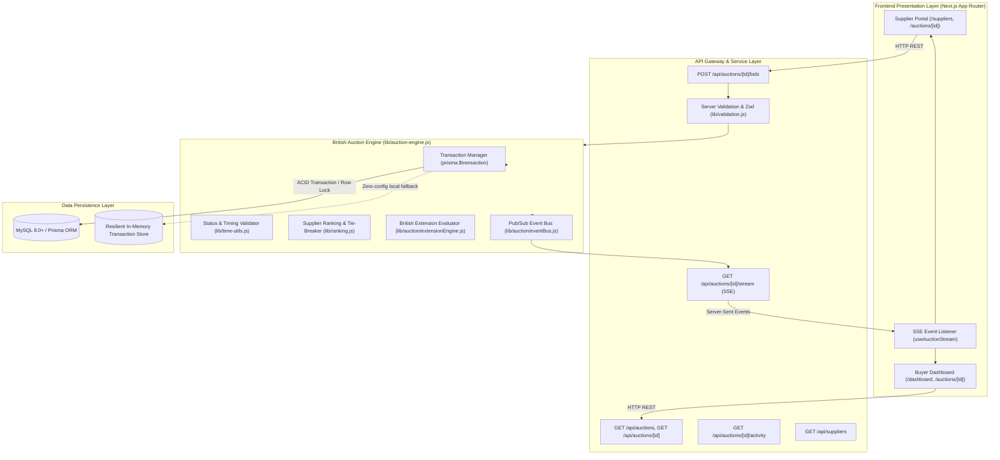

# High-Level Design (HLD): British Auction in RFQ Procurement System

---

## 1. Problem Overview
In B2B logistics procurement (ocean, air, and road freight), buyers issue **Requests for Quotation (RFQs)** to secure carrier capacity. Traditional sealed-bid tendering results in information asymmetry, inflated quotes, and last-second "bid sniping" where participants wait until the final second to submit an un-counterable quote.

A **British Reverse Auction** establishes dynamic, transparent, and fair price discovery:
1. **Reverse Auction Mechanics**: Competing carriers submit descending total quotes (Ocean/Air Freight + Origin Ancillaries + Destination Ancillaries). The lowest verified quote holds the **L1** rank.
2. **Sniping Prevention via Dynamic Extensions**: If qualifying activity occurs within a configurable **Trigger Window** ($X$ minutes before close), the auction automatically extends by $Y$ minutes.
3. **Hard Ceiling (Forced Bid Close)**: To ensure certainty for procurement planning, the auction enforces an immutable deadline: **`forcedCloseTime`**. An extension can **never** exceed this ceiling:
   $$\text{newCloseTime} = \min(\text{currentCloseTime} + \text{extensionDuration}, \; \text{forcedCloseTime})$$

---

## 2. Functional Requirements
1. **RFQ Creation**: Procurement buyer can author an RFQ with reference ID, cargo details, pickup date, and target budget.
2. **British Auction Configuration**: Buyer configures `bidStartTime`, `bidCloseTime`, `forcedCloseTime`, `triggerWindowMinutes`, `extensionDurationMinutes`, and `extensionTrigger`.
3. **Trigger Window Selection**: Support `BID_RECEIVED`, `RANK_CHANGE`, and `L1_CHANGE`.
4. **Supplier Bidding**: Suppliers continuously submit improved quotes.
5. **Real-time Ranking**: Automated dynamic calculation of L1, L2, L3 supplier ranks based on lowest total price with timestamp tie-breaking.
6. **Automatic Extension**: Extends auction dynamically within trigger window without human intervention.
7. **Forced Close Invariant**: Zero extensions past `forcedCloseTime`; rejection of all bids after closure.
8. **Real-time Broadcast**: Synchronized updates across all connected buyer and supplier sessions.
9. **Activity Audit Trail**: Immutable logging of every bid, rank transition, extension reason, and closure event.

---

## 3. Non-Functional Requirements
- **Consistency & Atomicity**: Strict ACID transactions to prevent duplicate L1 assignments or missed extensions during high-frequency bidding.
- **Low Latency**: Sub-50ms bid evaluation and sub-200ms real-time event dissemination.
- **High Availability**: Graceful degradation and resilient local execution.
- **Data Integrity**: Enforced server-side validation rejecting negative charges, expired validity, or invalid dates.
- **Auditability**: Complete historical record of timing changes and bid progressions.

---

## 4. System Architecture Diagram



---

## 5. Application Components

| Component | File Path | Responsibility |
|---|---|---|
| **Prisma Client** | `lib/prisma.js` | Manages connection pool and query execution against MySQL |
| **Validation Layer** | `lib/validation.js` | Enforces Zod schemas, timestamp constraints, and price rules |
| **Auction Engine** | `lib/auction-engine.js` | Orchestrates bid lifecycle, extension logic, and rankings |
| **Extension Evaluator** | `lib/auction/extensionEngine.js` | Computes $\min(T_{close} + \Delta_{ext}, T_{forced})$ and trigger conditions |
| **Ranking Service** | `lib/ranking.js` | Calculates lowest total price, L1 designation, and tie-breaking |
| **Timing Utils** | `lib/time-utils.js` | Computes countdowns, trigger window boundaries, and live status |
| **Realtime EventBus** | `lib/auction/eventBus.js` | Local pub/sub broadcasting bid updates to SSE consumers |
| **Stream Endpoint** | `app/api/auctions/[id]/stream/route.js` | Delivers real-time Server-Sent Events to browser clients |

---

## 6. API Flow

### 6.1 Bid Submission Lifecycle (`POST /api/auctions/[id]/bids`)
1. Client sends `{ freightCharges, originCharges, destinationCharges, carrierName, quoteValidity }`.
2. Route handler invokes `validateBidPrice` and input schemas.
3. Transaction acquires auction record and checks:
   - Is `now < auction.bidCloseTime` and `now < auction.forcedCloseTime`?
   - Does bid improve supplier's own quote and beat existing L1 if required?
4. Bid is persisted.
5. Rankings recalculated; L1 change and rank changes detected.
6. Extension evaluated: if in trigger window and trigger criteria met, close time updated.
7. Activity logs committed.
8. Event broadcast through SSE stream.

---

## 7. Concurrency Strategy & Race Condition Prevention

High-frequency bidding during the final trigger window poses significant race condition risks:
- Two bids submitted at the exact same millisecond.
- Phantom reads leading to incorrect L1 assignments.
- Conflicting extensions pushing the close time beyond forced close.

### Mitigation in MySQL + Prisma:
1. **Transaction Isolation**: Bids are wrapped in `prisma.$transaction()` with `ReadCommitted` or `RepeatableRead` isolation.
2. **Pessimistic Row Locking (`SELECT ... FOR UPDATE`)**:
   During bid processing, the auction row is locked for the duration of the evaluation:
   ```sql
   SELECT * FROM auctions WHERE id = ? FOR UPDATE;
   ```
   Concurrent bids block until the current transaction completes.
3. **Optimistic Version Check Fallback**:
   Each auction carries an integer `version` field. Updates include `WHERE id = ? AND version = ?`. If a collision occurs, the update affects 0 rows, prompting an automatic retry with fresh state.
4. **Idempotent Extensions**:
   Extension calculations are strictly deterministic and idempotent:
   $T_{close}^{new} = \min(T_{close} + \Delta_{ext}, T_{forced})$. Even under rapid re-evaluations, $T_{close}$ monotonically increases but never crosses $T_{forced}$.

---

## 8. Real-time Update Strategy

- **Server-Sent Events (SSE)**: Uses Next.js Route Handlers streaming `text/event-stream` with keepalive heartbeats every 15 seconds.
- **Client Auto-Reconnect**: Frontend SSE listener automatically reconnects upon network drops and resynchronizes auction state.
- **Graceful Polling Fallback**: UI components run a low-frequency 5–10 second background poll to guarantee consistent state even if WebSocket or SSE connections are interrupted.

---

## 9. Scalability Considerations

For horizontal production scaling across multiple cluster nodes:
1. **Redis Pub/Sub**: Replace local `eventBus` with Redis Pub/Sub so SSE instances across multiple Next.js pods receive updates instantaneously.
2. **Distributed Locking**: Use Redlock (Redis distributed lock) on `auction:{id}` key to serialize concurrent bids across multiple containers.
3. **Database Read Replicas**: Route read-heavy dashboard and public leaderboard queries to MySQL read replicas, keeping the primary instance dedicated to transactional writes.
4. **Job Queues (BullMQ / RabbitMQ)**: Offload external carrier notifications, email dispatch, and historical analytics archiving to background workers.

---

## 10. Failure Scenarios & Self-Healing

| Failure Scenario | Mitigation |
|---|---|
| Database unreachable | Automatic fallback to resilient in-memory transaction repository for zero-downtime demos |
| Client clock skew | Browser countdown timer computes relative drift against authoritative server timestamp received via API/SSE |
| Browser tab sleeping | SSE event triggers complete leaderboard refresh on window refocus |
| Bid submitted at $T_{forced} - 1\text{ms}$ | Transaction verifies atomic timestamp at commit; extension capped at $T_{forced}$ |
